<!-- Generated by generator/cli.ts from https://sebastien.morel.me/api: change the portfolio, not this file. -->

<a href="https://sebastien.morel.me">
<picture>
  <source media="(prefers-color-scheme: dark)" srcset="./assets/hero-dark.svg">
  
</picture>
</a>

I'm Sébastien, aka **Plopix**, I live in California, and I come from France. I am a **passionate technologist**, **architect**, and **problem-solver** who has gone all-in on AI: I build **agentic systems** that run in production, and I develop with agents every day. With a deep focus on **scalability**, **performance**, and **system architecture**, I orchestrate **agentic workflows** that multiply engineering output — combining **agents**, **custom skills**, **MCP servers**, and **CLI tools** to push the boundaries of what a team can ship.

_This is my space to share my experience, projects, and thoughts on AI-driven engineering and the ever-evolving tech landscape. Welcome!_

## 🤖 AI Workflow & Tooling

<picture>
  <source media="(prefers-color-scheme: dark)" srcset="./assets/terminal-dark.svg">
  
</picture>

<table>
<tr><td colspan="2" valign="top">🕸️ <b>Graph Engineering</b> Agent pipelines designed as <b>graphs</b>: planner, parallel workers and reviewer nodes with shared state, branching, retries and human checkpoints.</td></tr>
<tr><td width="50%" valign="top">🛠️ <b>Custom Skills</b> Authored agent skills like a <b>/write-a-prd</b> that generates structured <code>PRD.json</code> file for automated implementation.</td><td width="50%" valign="top">🔌 <b>MCP Servers &amp; CLI Tools</b> Remote <b>MCP servers</b> to extend agent capabilities and <b>CLI tools</b> to streamline agentic workflows.</td></tr>
<tr><td width="50%" valign="top">🔔 <b>Plugins</b> Custom notification plugins that alert me when agents need attention, complete tasks, or hit blockers.</td><td width="50%" valign="top">🌳 <b>Git Worktree Integration</b> Agents work in isolated Git worktrees, enabling parallel development without branch conflicts.</td></tr>
</table>

Operating as an <b>AI-augmented engineering team</b> — shipping faster, with higher quality, across more fronts.

## 🧩 Open Source

<table>
<tr><td width="50%" valign="top"><b><a href="https://missive-js.github.io/missive.js/">Missive.js</a></b> Creator · Maintainer 
<i>The Service Bus that you or your agent needed.</i> 
Fully-typed Service Bus for Node.js fueled by fancy Middlewares, Envelopes and Stamps. 
  </td><td width="50%" valign="top"><b><a href="https://crystallize.com/learn/open-source/sdks-and-libraries/js-api-client">Crystallize JS Api Client</a></b> Creator · Maintainer 
<i>Crystallize (Java|Type) script Client</i> 
Provides simplifications and helpers to easily fetch data from your Crystallize tenant. 
  </td></tr>
<tr><td width="50%" valign="top"><b><a href="https://sebastien.morel.me/cliffhanger/">CLIffhanger</a></b> Creator · Maintainer 
<i>Scripts to MCP Server tool in an instant.</i> 
A CLI that runs your scripts and exposes them as tools through a built-in, extensible MCP server. 
 </td><td width="50%" valign="top"><b><a href="https://bgit.dev/">Better Git</a></b> Creator · Maintainer 
<i>A better version of Git CLI</i> 
During the &quot;Better Hack&quot; Hackathon at Y Combinator organized by Better Auth. The theme was to make something existing better, we chose Git and we built a wrapper around it to make some command AI-augmented! 
 </td></tr>
</table>

  
🕰️ Legacy projects
 

- [Nova eZ SEO Bundle](https://novactive.github.io/NovaeZSEOBundle) — Optimized SEO management for eZ Platform
- [eZ Launchpad](https://ezsystems.github.io/launchpad/) — CLI tool to bootstrap an eZ Platform project Docker stack
- [Nova eZ Slack Bundle](https://github.com/Novactive/NovaeZSlackBundle) — Drive your CMS with this complete Slack integration
- [Nova eZ 2FA Bundle](https://github.com/Novactive/NovaeZ2FABundle) — Security first!
- [Nova eZ Cloudinary Bundle](https://github.com/Novactive/NovaeZCloudinaryBundle) — Images optimizations and manipulations by Cloudinary on top of variations
- [Nova eZ Fastly Image Optimizer Bundle](https://github.com/Novactive/NovaeZFastlyImageOptimizerBundle) — Images optimizations and manipulations by Fastly on top of variations
- [Nova eZ Protected Content Bundle](https://github.com/Novactive/NovaeZProtectedContentBundle) — Protect contents via a simple password without changing the Content Type
- [Plopix JS Console](https://github.com/plopix/js-console-wrapper) — A beautiful Console.log wrapper

## 🚀 Side Projects

<table>
<tr><td width="50%" valign="top"><b><a href="https://endless-chess.com">Endless Chess</a></b> 
Founder · Spring 2026 
Gamification layer for chess that turns the games you already play on Chess.com and Lichess into daily quests, streaks, XP, and rivalries. 
<code>Cloudflare</code> <code>Vite</code> <code>Tailwind CSS</code> <code>Chess.com API</code> <code>Lichess API</code> <code>Plausible Analytics</code></td><td width="50%" valign="top"><b><a href="https://color-conquest.com">Color Conquest</a></b> 
Founder · Spring 2026 
Browser-based, location-aware PvP game where players claim a permanent color identity and stake a real-world location, then battle for territory — winning absorbs an opponent&#39;s colors while losing drains your own. 
<code>Cloudflare</code> <code>Vite</code> <code>Tailwind CSS</code> <code>Plausible Analytics</code></td></tr>
<tr><td width="50%" valign="top"><b><a href="https://shipwire.dev">Shipwire</a></b> 
Founder · March 2026 
AI-powered tool that monitors GitHub repositories and delivers concise, automated digests of code changes to teams via Slack or Telegram on a customizable schedule. 
<code>Cloudflare</code> <code>Hobo JS</code> <code>GitHub API</code> <code>Slack API</code> <code>Telegram Bot API</code> <code>Better Auth</code></td><td width="50%" valign="top"><b><a href="https://time-capsule.io">Time Capsule</a></b> 
Co-Founder with my brothers. · Christmas 2025 
Digital time capsule platform that lets you lock messages, photos, and videos in the present to be revealed to yourself or loved ones at a chosen moment in the future. 
<code>Hono JS</code> <code>Custom React Island Frontend using Vite plugins</code> <code>Cloudflare</code> <code>Better Auth</code> <code>Stripe</code></td></tr>
<tr><td width="50%" valign="top"><b><a href="https://miape.fr">Miape</a></b> 
Co-Founder with my wife and two teacher friends. · Summer 2025 
Educational AI platform created by teachers for teachers, helping educators prepare teaching sequences, implement pedagogical differentiation, and strengthen student learning outcomes. 
<code>Next.js</code> <code>OpenAI API</code> <code>MongoDB</code> <code>Fly.io</code></td><td width="50%" valign="top"><b><a href="https://ok-wallace.com">Ok Wallace</a></b> 
Co-Founder with my French teacher wife. · November 2023, right after OpenAI released the first version of Assistant API. 
AI-powered educational platform that enables teachers to effortlessly create tailored and engaging assignments adapted to individual student learning styles and paces. 
<code>Remix Run</code> <code>OpenAI API</code> <code>MongoDB</code> <code>Fly.io</code> <code>Vector search</code></td></tr>
</table>

## ✍️ Latest publications & talks

<table>
<tr><th width="50%">📝 Publications</th><th width="50%">🎤 Talks & livestreams</th></tr>
<tr><td valign="top"><b><a href="https://crystallize.com/blog/claudette-ai-agent-at-crystallize">How We Gave an AI Agent Our Codebase Without Giving It the Keys?</a></b> Oct 2026 · Crystallize  
<b><a href="https://crystallize.com/blog/build-service-api">Build Your Crystallize Service API Like a Pro</a></b> Sep 2025 · Crystallize  
<b><a href="https://crystallize.com/blog/web-rendering">Web Rendering Explained: SSR, CSR &amp; SSG for High-Performance Sites</a></b> Jan 2025 · Crystallize  
<b><a href="https://crystallize.com/blog/subscriptions-api-overview">Subscriptions (API) Overview</a></b> Nov 2024 · Crystallize</td><td valign="top"><b><a href="https://youtu.be/Ge0DbLf-2R0?t=23593">Beyond Chat: When AI streams React components! Your cart has ideas!</a></b> Jun 2026 · React Norway 2026 · Rockefeller Oslo, Norway  
<b><a href="https://youtube.com/live/gk-oJs-g028">Build with Crystallize Using AI — Meet the MCP Server</a></b> Mar 2026 · Crystallize Channel · Online  
<b><a href="https://www.youtube.com/watch?v=A0jLC1yTqeM">I got interviewed by the NextDev.fm team!</a></b> Mar 2025 · NextDev.fm · Youtube Channel  
<b><a href="https://www.youtube.com/watch?v=VFNPyCWd-MQ">How to build a MCP Server</a></b> Mar 2025 · All Things Web · Youtube Channel</td></tr>
<tr><td align="right"><a href="https://sebastien.morel.me/publications">All publications →</a></td><td align="right"><a href="https://sebastien.morel.me/talks">All talks & livestreams →</a></td></tr>
</table>

## 🧰 Stack

<table>
<tr><td><b>AI &amp; Agentic Tooling</b></td><td>   </td></tr>
<tr><td><b>Living on the Edge</b></td><td>     </td></tr>
<tr><td><b>Professional</b></td><td>   </td></tr>
<tr><td><b>The Basics</b></td><td>             </td></tr>
</table>

  
🦕 Earlier stack
 

<table>
<tr><td><b>My Previous Life - Up to the Late 2010s</b></td><td>      </td></tr>
<tr><td><b>Old School</b></td><td>     </td></tr>
</table>

## 📊 Stats & badges

<a href="https://github.com/plopix">
<picture>
  <source media="(prefers-color-scheme: dark)" srcset="https://github-readme-stats.vercel.app/api?username=plopix&amp;count_private=true&amp;show_icons=true&amp;hide_title=true&amp;bg_color=171717&amp;border_color=404040&amp;text_color=d4d4d4&amp;icon_color=ff9900&amp;ring_color=ff9900">
  
</picture>
</a>

  
💯 More Stats
 
  
  

  
🎼 My Symfony Badges
 
  
  
  
  
  
  
  
  
  
  
  
  
  
  
  
  
  
  
  
  
  
  
  
  
  

<a href="https://sebastien.morel.me"><b>More on sebastien.morel.me →</b></a>

